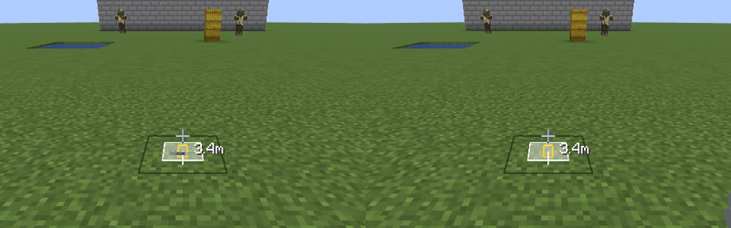
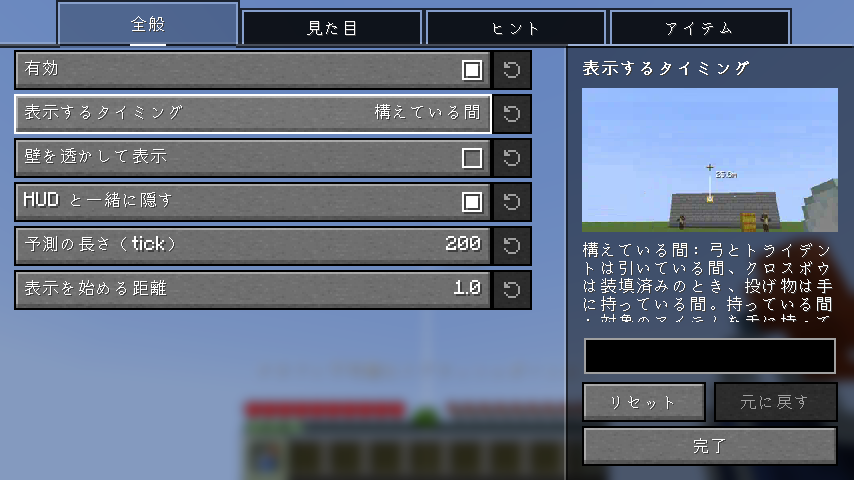

# AimPreview

[English](README.md) | 日本語

矢・トライデント・投げ物がどこを飛び、どこに当たるかを表示する Fabric 向けクライアント MOD です。
クライアントに入れるだけで動作し、バニラサーバーでも使えます（サーバー側への導入は不要です）。

## 機能

- **軌道と着弾点**：弓、クロスボウ（拡散の 3 本、花火は爆発する所まで）、トライデント、雪玉、卵、エンダーパール、スプラッシュ・残留ポーション、エンチャントの瓶、ウィンドチャージ、釣り竿に対応しています。
  弓とトライデントは引いている間、クロスボウは装填済みのとき、投げ物は手に持っている間に表示します。対象のアイテムを持っている間ずっと表示することもできます。

  

- **当たる相手の強調**：弾がエンティティに当たるときは、相手を枠で囲み、線を赤くし、音で知らせます。
- **ブレの範囲**：vanilla では撃つたびに弾が少しランダムにぶれるので、線から少しずれた所に当たることがあります。当たりうる範囲を、着弾点のまわりに囲んで表示します。

  

- **距離**：着弾点までの距離を照準の横に表示します。

  

- **飛んでいる弾**：すでに空中にある矢・トライデント・投げ物にも、この先の軌道を表示します。自分の弾だけにも、全員の弾にもできます。

  

- **線の種類**：実線・点線・小さな立方体の列から選べ、色と太さも変えられます。壁の向こうまで透かして表示することもできます。
  「画面の揺れ」が ON でも、歩いている間、手前の線は照準と一緒に止まって見えます。

  

## 設定

上の機能はすべて、[Mod Menu](https://modrinth.com/mod/modmenu) から開く設定画面で ON/OFF・調整できます。
主な項目には、その項目が変える見た目の短い映像が出ます。
MOD 全体を ON/OFF するキーは初期状態では未設定です。操作設定の「AimPreview」で割り当てます。

## 必要なもの

- [Fabric API](https://modrinth.com/mod/fabric-api)
- [YetAnotherConfigLib](https://modrinth.com/mod/yacl)
- [Mod Menu](https://modrinth.com/mod/modmenu)（任意。設定画面を開くのに使います）

対応する Minecraft のバージョンは、各リリースに書いてあります。

## 注意

線はブレのない中心の軌道です。実際の弾はブレの範囲のどこかに当たります。どこに当たるかは、撃った瞬間にサーバーが決めます。
弾の飛び方を変える MOD やサーバーのプラグインは考慮していません。

サーバーによっては、このような MOD の使用をルールで禁止していることがあります。遊ぶサーバーのルールに従ってください。
