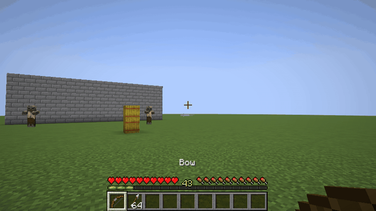
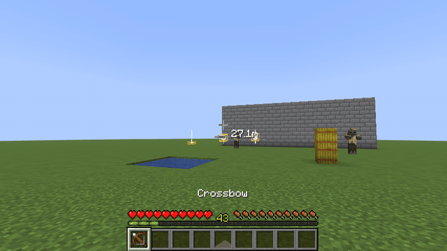
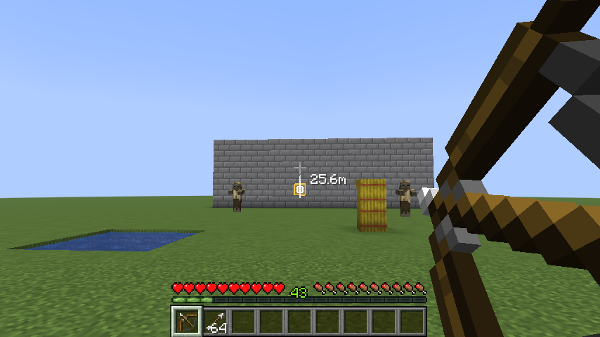
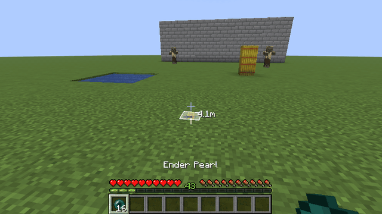
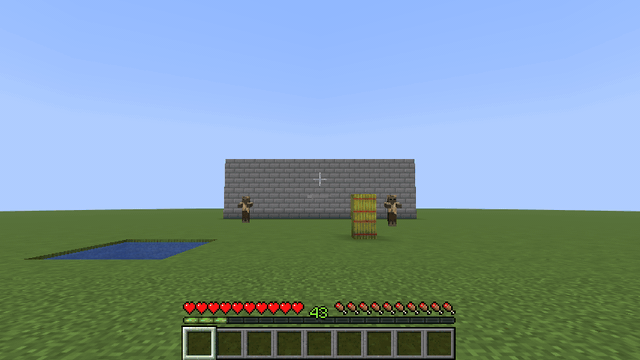
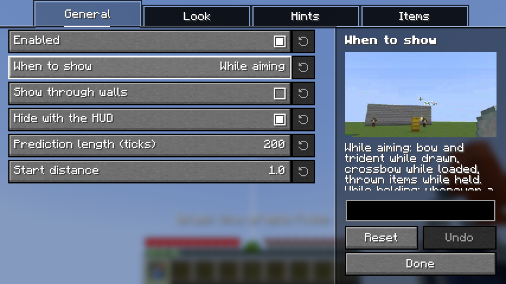

# AimPreview

English | [日本語](README.ja.md)

A client-side Fabric mod that shows where your arrows, tridents and thrown items will fly and land.
Just install it on your client; it also works on vanilla servers (nothing needs to be installed on the server).

## Features

- **Path and landing point**: for bows, crossbows (all three Multishot arrows, and fireworks up to where they explode), tridents, snowballs, eggs, ender pearls, splash and lingering potions, bottles o' enchanting, wind charges and fishing rods.
  Bows and tridents show it while drawn, crossbows while loaded, and thrown items while held. It can also be shown whenever a supported item is in your hand.

  

- **Target highlight**: when the shot would hit an entity, the entity is outlined, the line turns red and a sound plays.
- **Spread area**: vanilla adds a little random spread to every shot, so the shot can land slightly off the line. The area where it can land is outlined around the landing point.

  

- **Distance**: how far away the landing point is, next to the crosshair.

  

- **Projectiles in flight**: arrows, tridents and thrown items already in the air show the rest of their path, for your own projectiles or everyone's.

  

- **Line styles**: a solid line, a dashed line or a row of small cubes, in any color and width. The path can also be drawn through walls.
  While you walk, the line in front of you stays steady with the crosshair even with View Bobbing on.

## Settings

Everything above can be turned on or off and adjusted in the settings screen, opened from [Mod Menu](https://modrinth.com/mod/modmenu).
The main options show a short clip of what they change.
A key to turn the mod on and off is unbound by default; assign it under Controls → AimPreview.

## Requirements

- [Fabric API](https://modrinth.com/mod/fabric-api)
- [YetAnotherConfigLib](https://modrinth.com/mod/yacl)
- [Mod Menu](https://modrinth.com/mod/modmenu) (optional, for opening the settings screen)

The supported Minecraft versions are listed on each release.

## Note

The line is the shot without random spread. The real shot lands somewhere in the spread area; exactly where is decided by the server when it is fired.
Mods and server plugins that change how projectiles fly are not taken into account.

Some servers prohibit mods like this in their rules. Follow the rules of the server you play on.
